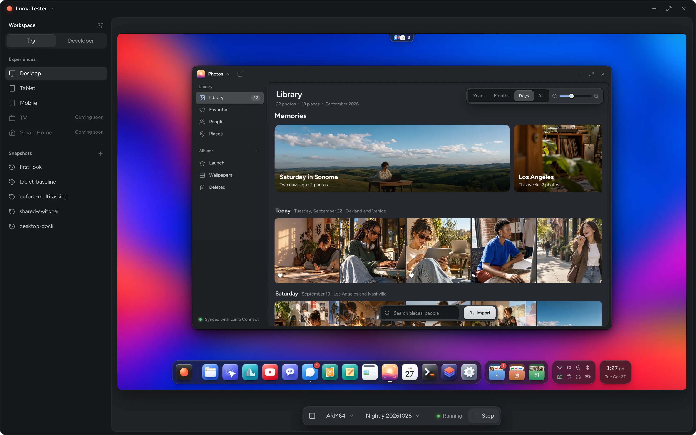

# Try Luma

The release home for **Try Luma** on macOS, Windows and Linux. Try Luma
Desktop, Tablet and Mobile locally, with persistent workspaces and snapshots.

The app downloads a prepared VM image when needed and boots directly into Luma
with automatic login. One x86-64 image and one ARM64 image serve Desktop, Tablet
and Mobile. Images are hosted on Luma’s download server; application packages
belong in this repository’s GitHub Releases.

## Download

Latest previews: [Linux 0.7.7](https://github.com/SimplyLuma/try/releases/tag/v0.7.7),
[macOS and Windows 0.7.6](https://github.com/SimplyLuma/try/releases/tag/v0.7.6).

- [macOS Apple silicon](https://github.com/SimplyLuma/try/releases/download/v0.7.6/Try.Luma-0.7.6-macos-arm64.dmg)
- [Windows x86-64](https://github.com/SimplyLuma/try/releases/download/v0.7.6/Try-Luma-0.7.6-windows-x86_64.zip)
- [Linux x86-64](https://github.com/SimplyLuma/try/releases/download/v0.7.7/Try-Luma-0.7.7-linux-x86_64.AppImage)

The macOS download is Developer ID signed and Apple notarized, with approval
tickets stapled to the app and disk image. Windows packages are unsigned.
Checksums and corresponding source are attached to the release. Mac guest graphics
use software rendering with complete-frame streaming and improved display refresh.

## Preview login

The sidebar shows the preview credentials in both Try and Developer modes:
username **luma**, password **TryLuma**, with a clickable password that copies to the clipboard. Use this
password when installing apps or unlocking the preview. Fresh previews disable
automatic locking and idle sleep. SSH requires a key.

## Source and builds

The application and shared LumaUI implementation are maintained together in
[SimplyLuma/luma](https://github.com/SimplyLuma/luma):

- Application: `src/luma-tester`
- Linux, macOS and Windows packagers: `scripts/tester`
- Build guidance: `docs/developer-platform/tester.md`

This repository holds the cross-platform release home and the curated image
channel. It does not fork the OS or shared UI platform. Generated applications
and multi-gigabyte OS images must not be committed to Git.

## Image channel

[`channels/images.json`](channels/images.json) approves exactly one prepared
preview image per CPU architecture. Both support Desktop, Tablet and Mobile.
Generation 7 includes the complete sizes, SHA-256 checksums and immutable URLs
of the verified direct-boot images. Unapproved historical downloads are hidden;
local imports and saved workspaces remain available. Legacy ISO approvals are
retained for older-client compatibility. See [the channel contract](channels/README.md).

## Application updates

Try Luma checks the Hub catalog for app updates. New packages must also be entered
into the signed Tester release index before that catalog can offer them. A newer package is selected for the host
OS and CPU, independently of the guest being emulated. Downloaded packages are verified and revealed for
installation; Try Luma does not replace a running app or restart an active VM.

Release packages require native validation and the authorized signing/publication
workflow. Their immutable URLs, sizes and checksums then enter the signed release
index. Publishing an OS image does not require publishing an app update.
